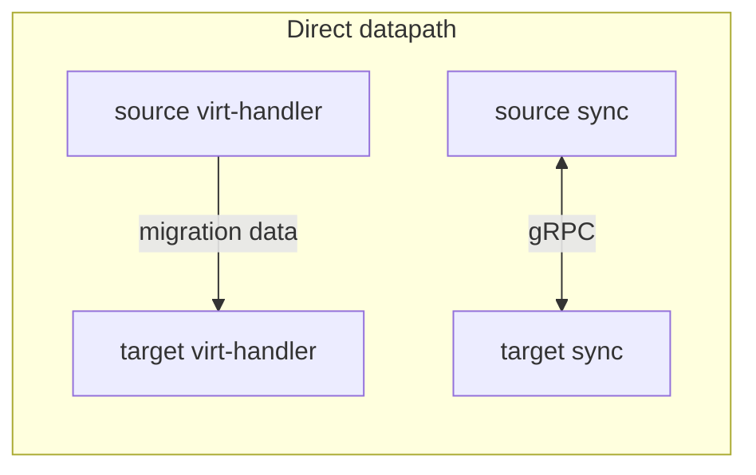
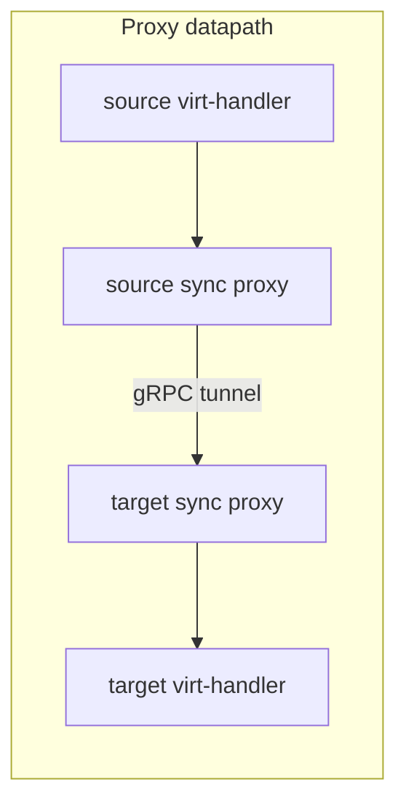

# Cross-cluster migration network

This page describes how to configure the network used by
[decentralized live migration](decentralized_live_migration.md) between
clusters. It covers the migration datapath, optional Multus
networks, and how to expose synchronization controllers over the pod network
with a Service, Ingress, or OpenShift Route.

For creating NetworkAttachmentDefinitions for a dedicated migration network,
see [Using a different network for migrations](live_migration.md#using-a-different-network-for-migrations).

## Overview

Decentralized live migration uses synchronization controllers on each cluster
to coordinate source and target `VirtualMachineInstance` state. Two kinds of
traffic are involved:

1. **Control plane** — peer gRPC between synchronization controllers. This synchronizes the migration state during the migration process. In order to connect to the remote cluster use the address published in `status.synchronizationAddresses` of the remote cluster KubeVirt CR. Put the value in the `sendTo.connectURL` field of the `VirtualMachineInstanceMigration`.
2. **Data plane** — In proxy mode, libvirt and NBD migration traffic that copies memory and disks. In direct mode the synchronization controller only sends control plane data.

You select how the data plane moves with
`spec.configuration.migrations.decentralizedLiveMigrationDatapath`:

| Value | Behavior |
|-------|----------|
| unset / `Direct` | Migration data goes directly between virt-handlers (default). |
| `Proxy` | Synchronization controllers proxy migration data on the sync gRPC port. |

To enabled the proxy, enable the following feature gate:
* `CrossClusterMigrationProxy` — required for `Proxy` while the feature is Alpha.

Cross-cluster TLS trust still requires exchanging CA material via `kubevirt-external-ca` as described in [Configuring KubeVirt CA with cross cluster live migration](decentralized_live_migration.md#configuring-kubevirt-ca-with-cross-cluster-live-migration).

## Architecture

### Direct datapath

With `Direct` mode, virt-handlers exchange migration data with each other. Sync controllers only exchange control-plane gRPC. Every virt-handler that participates must be reachable from peers on whatever address is advertised
for migration on a dedicated migration network.



### Proxy datapath

With `Proxy` mode, virt-handlers send migration data to the local synchronization controller. That controller tunnels the traffic to the peer synchronization controller,
which forwards it to the target virt-handler. Only the synchronization controllers need addresses on the cross-cluster path, which reduces the number of IPs required on a shared fabric.



Example: for 4 clusters with 10 virt-handlers each, Direct mode needs 48 cross-cluster addresses (4 * 10 virt-handlers + 4 * 2 synchronization controllers), while in Proxy mode one needs only 8 addresses (4 * 2 synchronization controllers). The 10 virt-handler addresses are now in a network inside the cluster (pod or dedicated live migration network).

## Configuration fields

Configure networking under `spec.configuration.migrations` on the KubeVirt CR:

| Field | Meaning |
|-------|---------|
| `decentralizedLiveMigrationDatapath` | `Direct` (default when unset) or `Proxy`. |
| `network` | Name of a Multus NetworkAttachmentDefinition attached as `migration0`. Used for virt-handler ↔ sync (and for Direct migration addresses). Omit to use the pod IP. |
| `crossClusterNetwork` | Name of a Multus NetworkAttachmentDefinition attached as `crosscluster0` for sync ↔ sync peer traffic. Valid only with `Proxy`. Omit to use the pod IP. |

Related KubeVirt CR fields:

* `spec.synchronizationPort` — peer gRPC listen port (default `9185`).
* `spec.synchronizationPlacement` — node placement for synchronization
  controllers (for example, nodes that have the cross-cluster NIC). By
  default, sync controllers use control-plane placement.

## Datapath and network combinations

| Datapath | `network` | `crossClusterNetwork` | Handler ↔ sync | Sync ↔ sync | Advertised sync address | Notes |
|----------|-----------|------------------------|----------------|-------------|-------------------------|-------|
| Direct | unset | unset | pod IP | pod IP | sync pod IP:`synchronizationPort` | **Invalid.** pod networks are not usually connected. |
| Direct | set | unset | `migration0` | `migration0` | `migration0` IP:port | Dedicated migration network; see [live migration network](live_migration.md#using-a-different-network-for-migrations). |
| Direct | \* | set | — | — | — | **Invalid.** `crossClusterNetwork` requires `Proxy`. |
| Proxy | unset | unset | pod IP | pod IP | labeled Route/Ingress/Service, else pod IP | Enables [external endpoint discovery](#proxy-on-the-pod-network-service-ingress-route). |
| Proxy | set | unset | `migration0` | pod IP | labeled Route/Ingress/Service, else pod IP | Sync controllers require `migration0` at startup. |
| Proxy | unset | set | pod IP | `crosscluster0` | `crosscluster0` IP:port | Labeled endpoint discovery is not used. |
| Proxy | set | set | `migration0` | `crosscluster0` | `crosscluster0` IP:port | Full dedicated Multus path. |

Invalid or incomplete configurations:

* `crossClusterNetwork` without `decentralizedLiveMigrationDatapath: Proxy` —
  rejected by the KubeVirt admitter.
* `Proxy` mode without the `CrossClusterMigrationProxy` feature gate — rejected.
* `network` set with `Proxy` mode, synchronization controllers attach to `migration0` and will not start if that interface is missing.
* `Direct` mode without migration network. This will cause the virt-handlers to only have IP addresses on the pod network, which are not connected to other clusters.

## Proxy with Multus networks

Create NetworkAttachmentDefinitions in the KubeVirt install namespace (default
`kubevirt`). Reuse the pattern from
[Creating a migration network on a cluster](live_migration.md#creating-a-migration-network-on-a-cluster)
for the local migration network, and create a second NAD for the
cross-cluster fabric (reachable between clusters).

Example KubeVirt configuration with both networks:

```yaml
apiVersion: kubevirt.io/v1
kind: KubeVirt
metadata:
  name: kubevirt
  namespace: kubevirt
spec:
  configuration:
    developerConfiguration:
      featureGates:
      - DecentralizedLiveMigration
      - CrossClusterMigrationProxy
    migrations:
      decentralizedLiveMigrationDatapath: Proxy
      network: migration-network
      crossClusterNetwork: crosscluster-network
  synchronizationPlacement: #optional in case your control plane nodes do not have access to the cross cluster migration network
    nodePlacement:
      nodeSelector:
        kubevirt.io/crosscluster-access: "true"
```

With this setup:

* virt-handlers and sync controllers use `migration0` inside the cluster. This is the in cluster migration network.
* Sync controllers bind peer gRPC on `crosscluster0`.
* `status.synchronizationAddresses` is taken from the `crosscluster0` address of the active sync controller. This is the cross cluster migration network.

You can omit either NAD to fall back to the pod IP for that leg (see the
[combinations table](#datapath-and-network-combinations)).

## Proxy on the pod network: Service / Ingress / Route

When `decentralizedLiveMigrationDatapath` is `Proxy` and
`crossClusterNetwork` is **not** set, the virt-operator can discover an
admin-supplied external endpoint and publish it in
`status.synchronizationAddresses`. That is the usual way to make sync
controllers reachable across clusters when you do not run a shared Multus
fabric.

### Discovery rules

Create exactly one of the following in the KubeVirt install namespace, and label
it:

```yaml
metadata:
  labels:
    kubevirt.io/synchronization-endpoint: "true"
```

Rules:

* Discovery runs only for Proxy **without** `crossClusterNetwork`.
* At most one labeled resource of each type (Route, Ingress, Service) may
  exist. Duplicates of the same type mark the KubeVirt CR
  `SynchronizationEndpoint` condition as `False` with reason
  `SynchronizationEndpointMisconfigured`.
* Priority when more than one type is labeled: **Route > Ingress > Service**.
* The label uses key-exists matching. The value is ignored; by convention use
  `"true"`. Setting `"false"` does **not** disable discovery — remove the
  label instead.
* If no labeled resource is found, the operator falls back to the sync
  controller pod IP.
* When a usable endpoint is found, condition `SynchronizationEndpoint` is
  `True` with reason `SynchronizationEndpointFound`.

Enable Proxy on the pod network first:

```yaml
apiVersion: kubevirt.io/v1
kind: KubeVirt
metadata:
  name: kubevirt
  namespace: kubevirt
spec:
  configuration:
    developerConfiguration:
      featureGates:
      - CrossClusterMigrationProxy
    migrations:
      decentralizedLiveMigrationDatapath: Proxy
```

KubeVirt does not create a Service for the synchronization controller by default. Create one that selects the sync controller pods, then optionally expose it with an Ingress or Route.

### Service

Prefer a Service port named `grpc` or `synchronization`. The container port
on the sync controller is named `sync` (default `9185`).

```yaml
apiVersion: v1
kind: Service
metadata:
  name: virt-synchronization-controller
  namespace: kubevirt
  labels:
    kubevirt.io/synchronization-endpoint: "true" #The operator looks for this label.
spec:
  selector:
    kubevirt.io: virt-synchronization-controller
  ports:
  - name: grpc
    port: 9185
    protocol: TCP
    targetPort: sync
  type: LoadBalancer
```

How the address is chosen:

* If the Service has a LoadBalancer ingress hostname or IP, that host and the selected Service port are advertised.
* Otherwise the cluster DNS name `name.namespace.svc` is advertised (for example `virt-synchronization-controller.kubevirt.svc:9185`). Peers must resolve and reach that name (for example via Submariner or another cross-cluster DNS/connectivity solution).

### Ingress

Label at most one Ingress. The operator advertises `host:443`. Your Ingress controller must forward TLS to the sync Service and support HTTP/2 (gRPC). Passthrough TLS is the usual approach.

```yaml
apiVersion: networking.k8s.io/v1
kind: Ingress
metadata:
  name: virt-synchronization-endpoint
  namespace: kubevirt
  labels:
    kubevirt.io/synchronization-endpoint: "true" #The operator looks for this label.
  annotations:
    # Example for nginx; use the equivalent passthrough annotation for your controller.
    nginx.ingress.kubernetes.io/ssl-passthrough: "true"
    nginx.ingress.kubernetes.io/backend-protocol: "GRPC"
spec:
  rules:
  - host: sync.example.com
    http:
      paths:
      - path: /
        pathType: Prefix
        backend:
          service:
            name: virt-synchronization-controller
            port:
              name: grpc
  tls:
  - hosts:
    - sync.example.com
```

`status.synchronizationAddresses` will contain something like
`sync.example.com:443`.

### Route (OpenShift)

On OpenShift, label at most one Route. The operator advertises the admitted
Route host on port `443`. Use **TLS passthrough**; edge or re-encrypt has not been tested. termination typically breaks gRPC/HTTP2 for this endpoint.

```yaml
apiVersion: route.openshift.io/v1
kind: Route
metadata:
  name: virt-synchronization-endpoint
  namespace: kubevirt
  labels:
    kubevirt.io/synchronization-endpoint: "true" #The operator looks for this label.
spec:
  host: sync.apps.example.com
  to:
    kind: Service
    name: virt-synchronization-controller
  port:
    targetPort: sync
  tls:
    termination: passthrough
    insecureEdgeTerminationPolicy: None
```

`status.synchronizationAddresses` will contain something like
`sync.apps.example.com:443`.

